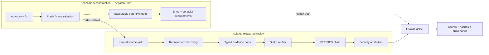
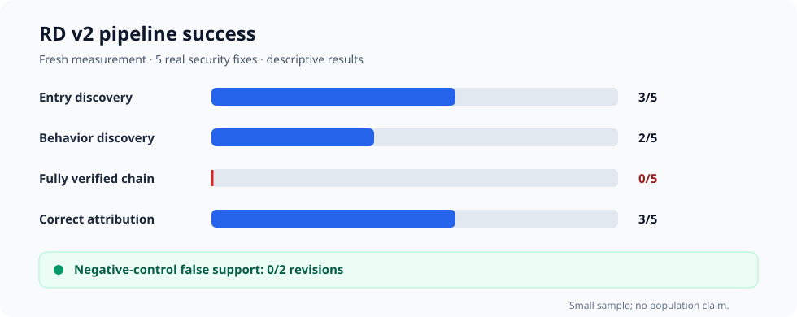

# Verifiable Security Review with LLM Agents

> A security-engineering framework for testing whether AI-assisted code review can produce
> machine-verifiable evidence for real vulnerability fixes.

This project grew out of a penetration-testing question: **can an AI-assisted reviewer produce
evidence I would actually trust in a security review, rather than just a plausible verdict?**

The repository combines vulnerability reproduction, secure code review, CodeQL-backed static
verification, isolated agent sessions, and frozen scoring. The central result is deliberately not
marketed away: the evaluated model often reached the right security conclusion without producing
a complete, auditable evidence chain.

**Fresh result:** 3/5 correct real-fix attributions, but 0/5 fully verified evidence chains.

**Stack:** Python · Go · CodeQL · Git plumbing · MCP · pytest

[Portfolio summary](docs/PORTFOLIO.md) · [Results](docs/RESULTS.md) ·
[Architecture](docs/ARCHITECTURE.md) · [Security engineering](docs/SECURITY_ENGINEERING.md) ·
[Resume bullets](docs/RESUME-BULLETS.md) · [Interview pitch](docs/INTERVIEW-PITCH.md)

## Why I built this

AppSec and penetration-testing work often ends with a deceptively simple question: did this commit
actually fix the reported vulnerability? A useful answer requires more than recognizing a risky
diff. It requires reproducing the behavior, identifying the exact security requirement, tracing
attacker-controlled input to the decision point, and preserving evidence another reviewer can
check.

LLMs can produce convincing explanations, but a correct verdict does not prove that the cited path
or guard is real. I built this project to separate those concerns and measure them independently on
real Go and Python security fixes.

## What I built



- **Fresh vulnerability fixtures:** frozen OSV snapshot, deterministic selection, bounded manual
  review, reserves, and rejection logs.
- **Executable truth:** the same trigger is exercised against parent and fix revisions through a
  regression test, advisory PoC, or minimal local probe.
- **Requirement discovery:** the reviewer must identify the claim-specific entry and the statement
  that permits or blocks the security effect.
- **Typed evidence:** source-to-decision hops are proposed under a frozen relation vocabulary.
- **Static verification:** CodeQL and custom providers return `VERIFIED`, `UNVERIFIED`,
  `CONTRADICTED`, or a declared unsupported boundary.
- **Fail-closed evaluation:** only verified edges form a chain; truth stays hidden until a sealed
  submission is scored; protocol mismatches stop the run rather than create a misleading metric.

The **benchmark-construction agent is not the evaluated agent**. Construction, adjudication,
measured review, and scoring are isolated roles.

## Key results

### Fresh RD v2 measurement

RD v2 ran six preregistered sessions: five real security fixes and one negative control. The harness
was valid (`harness_ok=true`).

| Measure | Frozen result |
|---|---:|
| Entry requirement discovered | **3/5** |
| Behavior requirement discovered | **2/5** |
| Fully verified evidence chain | **0/5** |
| Correct real-fix attribution | **3/5** |
| False support on the negative control | **0/2 revisions** |



**The model often reached the correct security conclusion without producing a complete
machine-verifiable evidence chain.** Three tasks had correct fix attribution despite wrong or
incomplete requirement/evidence artifacts. That gap is the main finding—not a score to hide.

### Earlier architecture feasibility

Before the fresh RD evaluation, chain replication tested whether the local typed-hop architecture
could work when the evidence contract was already known. It produced **18/30 fully VERIFIED
chains**: Authlib **10/10**, Caddy **3/10**, and File Browser **5/10**. This is feasibility evidence
for the architecture, not the final fresh-fixture result and not a population estimate.

### RD v3 fail-closed termination

RD v3 terminated before any model call because an independent held-out curator case exposed a
mismatch between the public construction contract and the frozen validator. The benchmark failed
closed instead of producing invalid measurements: **0 model calls, $0 spend, no resampling, and no
post-result repair**.

See [the compressed results history](docs/RESULTS.md) for how each stage led to the next.

## What this demonstrates

- Reproducing and validating real vulnerability behavior across parent/fix revisions.
- Secure code review across Go and Python, including precise entry, guard, dispatch, and data-flow
  reasoning.
- Building regression tests, advisory-PoC harnesses, and bounded minimal probes.
- Writing Python automation and CodeQL queries for evidence verification.
- Designing negative controls and handling unsupported evidence without converting uncertainty into
  a positive claim.
- Isolating agent sessions, freezing scorers, and preserving hashes, seals, append-only logs, and
  rejected runs.
- Using LLM agents as one component in a controlled AppSec workflow—not as an authority.

The implementation includes more than 100 Python/Go/QL source files and **271 passing tests**
covering anchors, revision isolation, scoring, budgets, provider behavior, chain classification,
truth matching, and protocol freezes.

## Architecture and code map

| Area | Start here |
|---|---|
| Revision-scoped source access and runtime-minted anchors | [`src/spike/`](src/spike/) |
| Real differential fixtures and executable truth | [`fixtures/`](fixtures/) and [`experiments/rd/truth/fixtures/`](experiments/rd/truth/fixtures/) |
| CodeQL typed-hop providers | [`experiments/hop_bridge/queries/`](experiments/hop_bridge/queries/) |
| Chain construction and classification | [`experiments/hop_chain/`](experiments/hop_chain/) |
| Fresh-fixture selection and requirement truth | [`experiments/rd/`](experiments/rd/) |
| Evaluated agent and frozen scoring | [`experiments/rd/agent/`](experiments/rd/agent/) |
| Frozen outcomes | [`results/`](results/) |
| Tests | [`tests/`](tests/) |

For component boundaries, data flow, and safety controls, see
[`docs/ARCHITECTURE.md`](docs/ARCHITECTURE.md). A validated standalone interactive diagram is also
available at [`docs/diagrams/security-review-architecture.html`](docs/diagrams/security-review-architecture.html)
(download and open locally).

## Example: validating the SiYuan fix

- **Vulnerability:** attacker-controlled HTML referenced a local server path; the vulnerable
  revision copied the file into web-accessible assets, producing an information-disclosure effect.
- **Differential proof:** the same request returned a retrievable byte-identical copy of the target
  file on the parent revision and no asset on the fixed revision.
- **Required entry:** `localPath := n.TokensStr()`—the first claim-specific local-path value, not
  the more general request body.
- **Required behavior:** the fix-side `if util.IsSensitivePath(localPath) {` guard.
- **Measured outcome:** the agent identified the behavior but selected an overly upstream entry;
  the reference audit also exposed a provider blind spot from predicate argument to enclosing guard.

This example captures the distinction the project measures: understanding the vulnerability is not
the same as submitting the exact, machine-verifiable artifact required for an audit.

## Reproducibility

The authoritative historical contract is [`PREREGISTRATION.md`](PREREGISTRATION.md). Frozen JSON
results, human-readable reports, commit IDs, hashes, model configuration, and cost accounting are
under [`results/`](results/). Raw run and review artifacts remain gitignored; the committed reports
contain the durable provenance needed to interpret outcomes.

Safe, non-model validation commands:

```bash
uv sync --frozen
uv run pytest

# Read-only integrity/status checks; these do not start agent sessions.
uv run python experiments/rd/selection.py status
uv run python experiments/rd/agent/v3/rdv3_freeze.py verify
```

No experiment command is required to inspect the portfolio. Start with
[`results/rd-agent-v2.md`](results/rd-agent-v2.md),
[`results/chain-replication.md`](results/chain-replication.md), and
[`results/rd-agent-v3.md`](results/rd-agent-v3.md).

## Limitations

- The fresh RD sample contains five real fixes and one negative-control task; all rates are
  descriptive and have wide uncertainty.
- Provider coverage is intentionally bounded. Callback binding, control dependency, dynamic
  dispatch, and some predicate-to-guard links remained blind spots.
- Exact evidence contracts can be brittle: node granularity and reference-chain direction affected
  admissibility and scoring.
- RD v3 produced no model measurement; its result is a protocol rejection, not evidence that the
  treatment improved or regressed.
- The evaluated configurations cover a small number of model and fixture families and do not imply
  production or population-level performance.

The project is complete as a research artifact. Negative, ambiguous, and invalid results are kept
because knowing when **not** to trust or score a security conclusion is part of the engineering.
