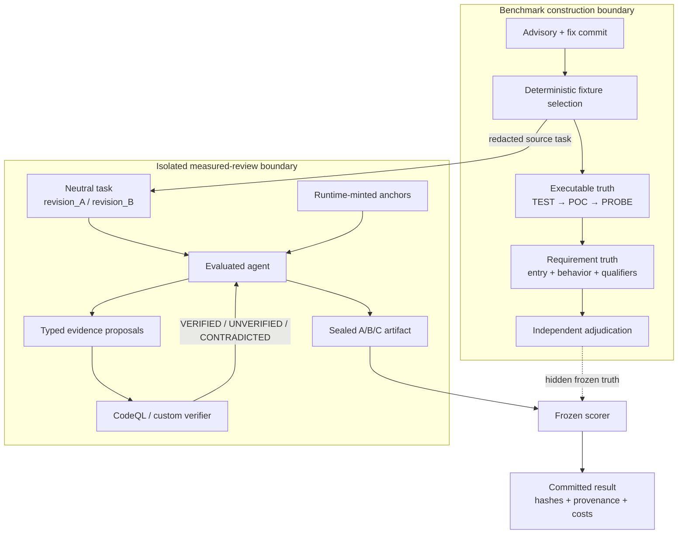
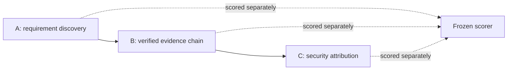

# Architecture

The system treats an LLM as an untrusted security-review participant. It can search code, identify
requirements, and propose evidence, but it cannot mint its own citations, mark its own hops as
verified, see the golden truth, or score itself.

> **Benchmark-construction agent != evaluated agent.** Truth authoring, adjudication, measured
> review, provider verification, and scoring are separate roles with different inputs.

## End-to-end flow

The [standalone interactive architecture diagram](diagrams/security-review-architecture.html) is a
zero-service HTML artifact (download and open locally). Its source specification is
[`diagrams/security-review-architecture.json`](diagrams/security-review-architecture.json).

## Components

| Component | Responsibility | Implementation |
|---|---|---|
| Benchmark selection | Freeze candidate population, screen diffs, enforce repository/CWE quotas, record rejections | [`experiments/rd/selection.py`](../experiments/rd/selection.py) |
| Executable truth | Demonstrate the same security-relevant trigger on parent and fix revisions | [`fixtures/*/truth/`](../fixtures/) and [`experiments/rd/truth/fixtures/`](../experiments/rd/truth/fixtures/) |
| Requirement truth | Define exact entry, behavior, qualifiers, revision state, and distractors | [`experiments/rd/truth/`](../experiments/rd/truth/) |
| Neutral task builder | Replace canonical roles with opaque revision labels and remove advisory/truth material | [`experiments/rd/agent/tasks.py`](../experiments/rd/agent/tasks.py) |
| Evaluated agent | Discover requirements, propose evidence, and submit attribution in an isolated session | [`experiments/rd/agent/session.py`](../experiments/rd/agent/session.py) |
| Provider/verifier | Check typed evidence edges against frozen CodeQL/custom relations | [`experiments/hop_bridge/queries/`](../experiments/hop_bridge/queries/) and [`experiments/rd/agent/verifiability.py`](../experiments/rd/agent/verifiability.py) |
| Chain classifier | Decide whether verified edges connect required entry, terminal, and qualifiers | [`experiments/hop_chain/chain.py`](../experiments/hop_chain/chain.py) |
| Frozen scorer | Compare sealed artifacts with hidden truth and fail closed on provenance drift | [`experiments/rd/agent/score.py`](../experiments/rd/agent/score.py) |
| Provenance layer | Issue revision-scoped anchors, log tool calls, bind hashes, and prevent cross-revision citation | [`src/spike/`](../src/spike/) |

## Evidence model

The evaluated agent does not submit arbitrary line numbers. Code-reading tools mint handles for
source already returned in that session. A citation is valid only when:

1. the anchor was issued by that session;
2. it belongs to the claimed revision;
3. any narrowed quote has a unique match inside the anchor;
4. the frozen resolver accepts the required node granularity.

Evidence paths are sequences of typed hops. Provider states have deliberately different meanings:

- `VERIFIED`: the frozen provider proved the proposed relation; eligible for a chain.
- `UNVERIFIED`: the provider could not prove it; absence of proof is not contradiction.
- `CONTRADICTED`: a conservative shape/type check proves the proposed relation is wrong.
- `unsupported`: the relation is outside the frozen provider vocabulary and remains an explicit
  blind spot.

Only `VERIFIED` edges contribute to a full chain.

## Scoring layers

- **A:** Did the agent identify the exact claim-specific entry, behavior, and necessary qualifiers?
- **B:** Do machine-verified edges realize the required path in each applicable revision?
- **C:** Did the agent correctly attribute the security effect to the change?

Keeping these layers separate is what exposed `A_WRONG_C_CORRECT`: a correct final attribution with
an inadequate reasoning artifact.

## Provenance and tamper resistance

- Git objects are read directly by commit; the agent sees neutral revision names rather than SHAs,
  branches, or commit messages.
- Source, prompts, providers, selection scripts, scorers, and results are hash-bound at their freeze
  points.
- Selection records use an append-only hash chain.
- Results are scored and committed before qualitative transcript inspection.
- Invalid attempts remain in provenance and can only be retried under frozen infrastructure-only
  rules.
- Raw `runs/` and review bundles are gitignored to avoid publishing redundant/sensitive operational
  artifacts; durable summaries and hashes are committed.

## Safety and isolation boundaries

- Measured sessions start from empty temporary working directories with empty agent memory.
- Tools are allowlisted; external tools and foreign MCP surfaces are rejected.
- Advisory files, release notes, canonical vulnerable/fixed labels, golden requirements, and scores
  are hidden from the evaluated agent.
- Budgets, timeouts, tool-call caps, and retry eligibility are recorded per session.
- A harness or contract mismatch stops measurement; it cannot be converted into a model score.
